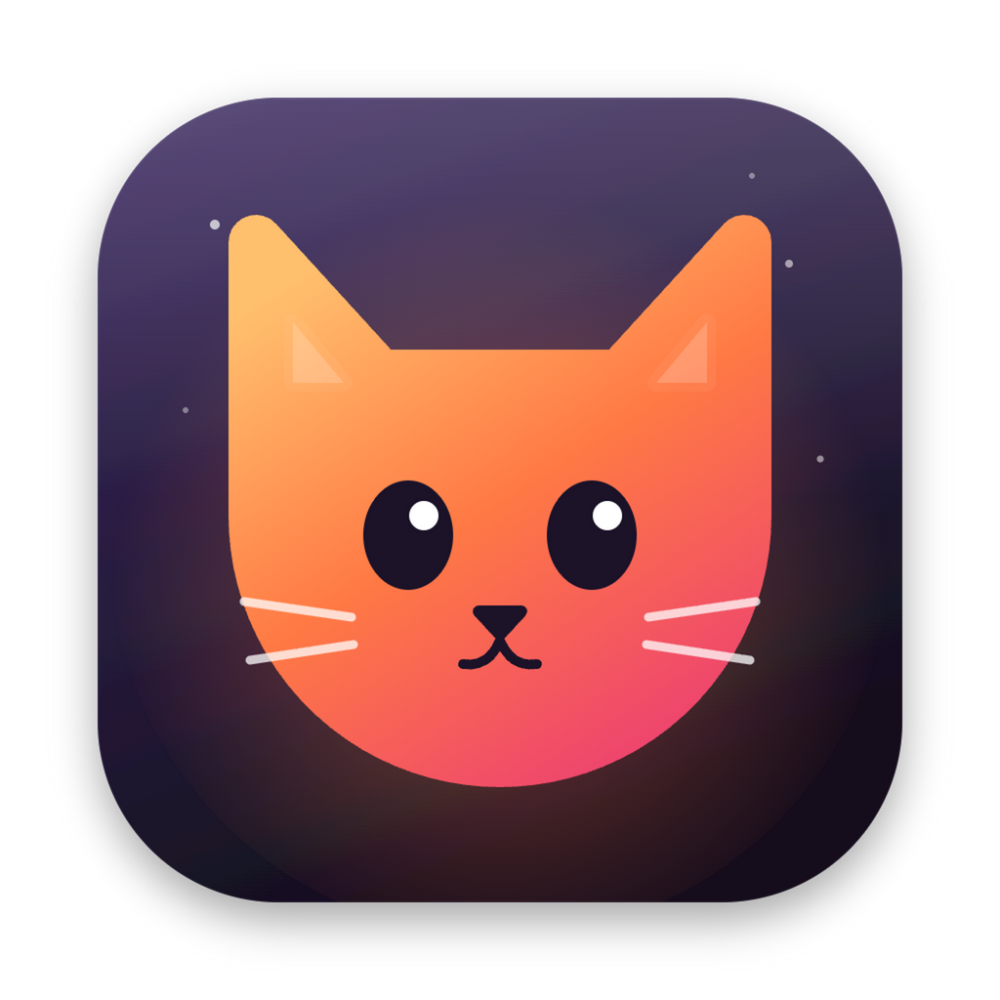
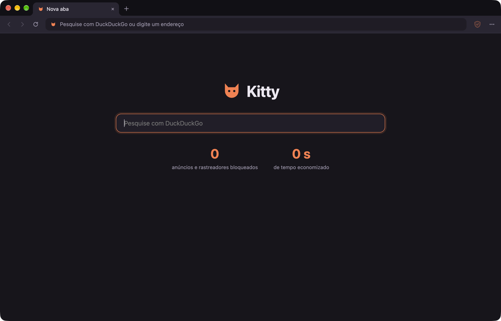
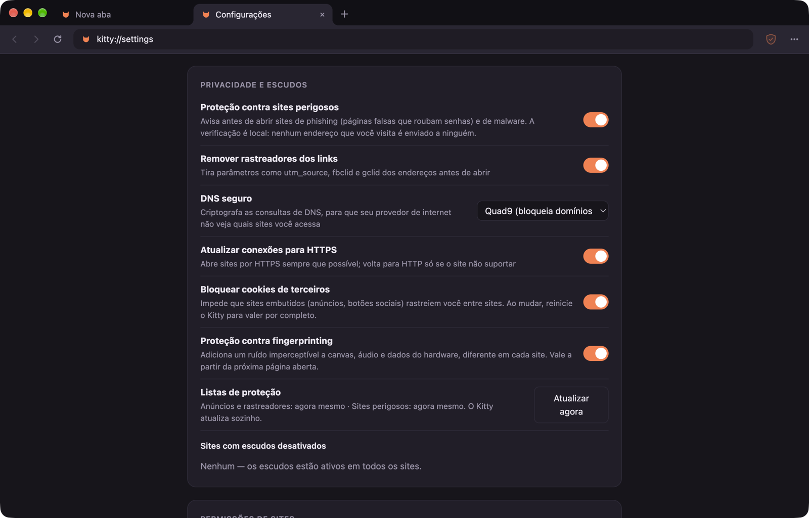

<div align="center">
    
    <h1>Kitty</h1>
    <p>
        The fast, good-looking, privacy-focused browser.
    </p>
    <a href="https://github.com/CaioGobbi/kitty-browser/releases/latest">Download</a>
    ·
    <a href="#features">Features</a>
    ·
    <a href="#building">Building</a>
    <br /><br />
    <a href="https://buymeacoffee.com/caiogobbii"></a>
</div>

<br />

Kitty is built on Chromium (through Electron), in the same spirit as Brave. It blocks ads and trackers, protects you against fingerprinting and phishing, and sends none of your data anywhere: there's no account, no telemetry and no Kitty server.

It runs on Windows, macOS and Linux.





## Download
> [!NOTE]
> Kitty is still young, so some things may not work as expected.
> If you run into a problem, please [open an issue](https://github.com/CaioGobbi/kitty-browser/issues).

Every version is on [GitHub Releases](https://github.com/CaioGobbi/kitty-browser/releases/latest), with the files grouped by system:

- **Windows 10/11 (64-bit):** `Kitty-Setup-*.exe`. Kitty updates itself once installed.
- **macOS (Apple Silicon, M1 or newer):** `Kitty-*-mac-arm64.dmg`. Open it and drag Kitty to Applications. Since 0.3.3 it updates itself; if you have an older version, download the new DMG once.
- **Linux (64-bit):** install it with one line in the terminal, which downloads the latest version (run it again to update):

  ```bash
  curl -fsSL https://raw.githubusercontent.com/CaioGobbi/kitty-browser/main/install.sh | sh
  ```

  On Debian, Ubuntu and derivatives it installs the `.deb`; on Fedora and openSUSE, the `.rpm`; on other distributions, the `.AppImage` in `~/.local/bin` (needs the FUSE 2 library). All three files are also on Releases if you'd rather install by hand. The command is `kitty-browser`, so it doesn't clash with the kitty terminal.

> [!WARNING]
> Kitty isn't signed by Microsoft or Apple yet, so your system will warn you the first time.
> - **Windows:** on the SmartScreen warning, click **More info → Run anyway**.
> - **Mac:** open Kitty once and dismiss the warning, go to **System Settings → Privacy & Security**, scroll to the bottom and click **Open Anyway**. After that it opens normally.

On Windows, the installer installs for the current user only (no administrator needed), creates shortcuts on the desktop and in the Start menu, and registers Kitty as a browser so it shows up in Settings → Apps → Default apps. Uninstalling removes all of that, and your data stays in `%APPDATA%\Kitty`.

## Features

**Privacy**
- **Shields**: ad and tracker blocking with the same lists uBlock Origin enables by default (EasyList, EasyPrivacy, Peter Lowe's and uBlock's own), including cosmetic filters, adjustable per site. On YouTube, ads are muted, sped up and skipped right away, without touching the player's data
- **Private window** (`⇧⌘N`): nothing is saved, and everything is gone when you close it
- **Automatic HTTPS**, falling back to HTTP only when the site doesn't support it
- **Third-party cookies blocked**, including those set by scripts inside iframes
- **Dangerous site protection**: warns you before opening phishing and malware (malware-filter, URLhaus and uBlock Origin lists), all checked locally
- **Tracker-free links**: strips `utm_*`, `fbclid`, `gclid` and the like before opening
- **Secure DNS** (DNS over HTTPS) with Quad9, Cloudflare or Mullvad
- **Same User-Agent as Chrome**, without revealing Electron or Kitty
- **Fingerprinting protection**: per-site noise in canvas, WebGL, audio, font measurement, screen, hardware and workers, Brave-style, and it can be turned off for a single site
- **WebRTC** doesn't expose local network addresses
- **No connections before you say so**: on first launch, a welcome screen asks which automatic connections to allow (list updates, app updates, Widevine) before Kitty connects to anything
- Block lists **update automatically** (ads every 24 h, threats every 6 h)
- **Site permissions**: camera, microphone, location and notifications only with your OK, editable per site
- **Global Privacy Control** (`Sec-GPC` and `navigator.globalPrivacyControl`)

**Browsing**
- Tabs: pin, drag to reorder, drag out into a new window (or into another window), mute, duplicate, close others, reopen closed (`⇧⌘T`), middle-click to close
- Three tab layouts: classic, compact (everything on one line) and vertical tabs
- Light, dark or automatic theme
- Interface in English or Portuguese (Brazil)
- Gestures: swipe two fingers on the trackpad to go back/forward (or three, if your Mac is set up that way) and the mouse side buttons
- Address bar with suggestions from history, bookmarks and the search engine
- Bookmarks with folders, an editable bookmarks bar (`⇧⌘B`) and a management page
- Local password manager: offers to save logins and fills them in, with no sync and no account
- Chrome extensions, installed straight from the Chrome Web Store
- Imports bookmarks and history from Chrome, Brave, Edge, Vivaldi, Opera, Arc and Firefox
- Speed dial on the new tab, with site icons
- Find in page (`⌘F`), video fullscreen, zoom, print, save page, view source
- Full right-click menu (links, images, text, spell check, inspect)
- Downloads straight to your Downloads folder, with a progress panel, pause and cancel
- Restores your tabs on relaunch; multiple windows; can be the default browser
- Search engines: DuckDuckGo, Brave Search, Startpage, Ecosia or Google
- DRM video through Widevine (Castlabs), with VMP signing: Crunchyroll, Netflix and other streaming services work

Everything can be adjusted in `kitty://settings` (`⌘,`).

## Shortcuts

| Action | Mac | Windows / Linux |
| --- | --- | --- |
| New tab / window / private window | `⌘T` / `⌘N` / `⇧⌘N` | `Ctrl+T` / `Ctrl+N` / `Ctrl+Shift+N` |
| Close tab / reopen closed | `⌘W` / `⇧⌘T` | `Ctrl+W` / `Ctrl+Shift+T` |
| Address bar | `⌘L` | `Ctrl+L` |
| Find in page | `⌘F` (`⌘G` next) | `Ctrl+F` (`Ctrl+G` next) |
| Bookmark / bookmarks bar | `⌘D` / `⇧⌘B` | `Ctrl+D` / `Ctrl+Shift+B` |
| History / downloads | `⌘Y` / `⇧⌘J` | `Ctrl+H` / `Ctrl+J` |
| Settings | `⌘,` | `Ctrl+,` |
| Back / Forward | `⌘[` / `⌘]` | `Alt+←` / `Alt+→` |
| Reload (bypass cache) | `⌘R` (`⇧⌘R`) | `F5` (`Ctrl+F5`) |
| Developer tools | `⌥⌘I` | `F12` |

On Windows and Linux, `F11` (fullscreen) and `Ctrl+Tab`/`Ctrl+PageDown` to switch tabs also work.

## Building

You need [Node.js](https://nodejs.org) (current version) and git.

```bash
git clone https://github.com/CaioGobbi/kitty-browser.git
cd kitty-browser
npm install
npm start
```

`npm install` downloads Castlabs' Electron (Chromium with Widevine). To test without touching your profile: `KITTY_PROFILE=/tmp/kitty-test npm start`.

### Building on a Mac

You need a Mac with Apple Silicon and the Xcode command line tools (`xcode-select --install`), used to build the native module for trackpad gestures.

```bash
npm run install-app
```

This builds `Kitty.app`, signs it locally and copies it to `/Applications`. To only build the app into `out/`, use `npm run dist`. To regenerate the icon from `assets/icon.svg`, use `npm run icon`.

### Building the Windows installer

```bash
npm run dist:win
```

This builds `out/windows/Kitty-Setup-<version>.exe` (Windows 10/11, 64-bit); you can build it straight from a Mac.

### Building the Linux packages

```bash
npm run dist:linux
```

This builds the `.AppImage` and `.deb` (x64) into `out/linux/`; you can build them straight from a Mac. The `.rpm` needs `rpmbuild`, so `npm run release:linux` builds it in a Docker container.

### Crunchyroll, Netflix and other DRM services

These services only release the video license (Widevine) to apps with a **VMP** signature, which Castlabs issues for free through its EVS service. Published Kitty versions are already signed. Without the signature Kitty works normally; only those videos won't play. To sign your own builds, create an EVS account once:

```bash
python3 -m venv .venv
.venv/bin/pip install castlabs-evs
npm run evs-signup
```

After that, `npm run dist` (Mac) and `npm run dist:win` (Windows) sign automatically. On the Mac the VMP signature is applied before Apple's code signature; on Windows, after.

### Publishing a version (maintainers)

Bump the version in `package.json`, optionally describe the changes in `docs/releases/<version>.md`, commit, and run `npm run release:win` (needs `gh auth login`). The script builds the installer and creates the release on GitHub, from which installed copies of Kitty on Windows update themselves. Then run `npm run release:mac`, which builds the Mac DMG and update and attaches them to the same release, and `npm run release:linux`, which does the same with the Linux packages (the code must have no uncommitted changes). Each script rewrites the release notes with the changes and a download section per system, linking to the files attached so far (`scripts/release-notes.sh`).

## Project layout

```
src/main/   main process
  main.js        startup, IPC, bookmarks, suggestions, settings
  window.js      windows: tabs, layout, fullscreen, find, permissions
  privacy.js     shields, HTTPS, cookies, links, dangerous sites, permissions
  lists.js       block and threat lists, with automatic updates
  importer.js    importing from other browsers
  passwords.js   saved passwords
  extensions.js  Chrome extensions
  updater.js     automatic updates (Windows and Mac)
  downloads.js   download manager
  menus.js       app menu and right-click menus
  preload-*.js   protections that run inside pages (fingerprinting, scriptlets)
src/i18n/   interface languages
src/ui/     tab strip and toolbar
src/pages/  internal pages (new tab, history, bookmarks, settings, errors)
native/     native module for trackpad gestures (macOS)
assets/     app icon and installer files
scripts/    icon generation, signing and publishing
```

User data lives in `~/Library/Application Support/Kitty` on the Mac, `%APPDATA%\Kitty` on Windows and `~/.config/Kitty` on Linux.

## Contributing

Found a bug or have an idea? Open an [issue](https://github.com/CaioGobbi/kitty-browser/issues). Pull requests are welcome.

## Support

Kitty is free, with no ads and no data collection. If it helps you, you can support the project:

<a href="https://buymeacoffee.com/caiogobbii"></a>

Or through [GitHub Sponsors](https://github.com/sponsors/CaioGobbi), with the **Sponsor** button at the top of the page.

## License

[MPL-2.0](LICENSE), the same as Firefox.
